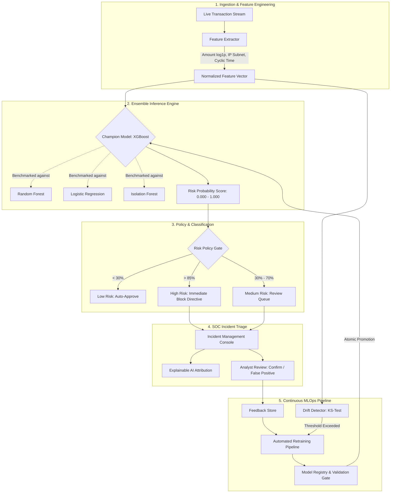

# ⚡ FraudPulse — Autonomous Fraud Intelligence & Real-Time MLOps Platform

[](https://opensource.org/licenses/MIT)
[](https://www.python.org/)
[](https://fastapi.tiangolo.com/)
[](https://react.dev/)
[](https://www.typescriptlang.org/)
[](https://vitejs.dev/)
[](https://tailwindcss.com/)
[](https://xgboost.readthedocs.io/)

**FraudPulse** is an enterprise-grade autonomous fraud intelligence, transaction risk scoring, and continuous MLOps platform. Engineered for mission-critical financial applications and cyber security operations centers (SOC), FraudPulse provides sub-50ms real-time risk classification, explainable anomaly reasoning, automated drift detection, and a human-in-the-loop retraining pipeline.

---

## 🌟 Executive Overview

Modern financial systems face sophisticated fraudulent tactics with evolving velocity and patterns. Traditional rule-based scoring systems suffer from high false-positive rates and slow adaptation cycles.

FraudPulse bridges cybersecurity telemetry and machine learning operations by providing:
- **Real-Time Risk Classification**: Sub-50ms inference latency for live payment streams.
- **Explainable AI (XAI)**: Context-aware anomaly attribution explaining *why* an event was flagged.
- **Ensemble Model Tournament**: Automated benchmarking between XGBoost, Random Forest, Logistic Regression, and Isolation Forest.
- **Closed-Loop MLOps**: Continuous feature drift surveillance and one-click/automated champion model retraining and atomic hot-swapping.
- **Resilient Fallback Design**: Client-side heuristic calculation keeps operations active even during edge network partitions.

---

## 🏗️ 5-Tier Platform Architecture



---

## ⚡ Key Production Metrics & Benchmarks

| Metric | Target SLA | FraudPulse Benchmark | Status |
| :--- | :--- | :--- | :--- |
| **Inference Scoring Latency** | `< 50ms` | **~42ms** (Lifespan Memory Mapped) | Optimal |
| **Champion Model Accuracy** | `> 88.0%` | **90.9%** (XGBoost Ensemble) | Optimal |
| **Champion Model F1-Score** | `> 0.650` | **0.6829** | Optimal |
| **False Positive Rate (FPR)** | `< 5.0%` | **3.8%** | Controlled |
| **Throughput Velocity** | `500+ tx/s` | **800 - 1,200 tx/s** | High Scale |

---

## 📁 Repository Structure

```text
FraudPulse/
├── .github/
│   └── workflows/
│       └── mlops-pipeline.yml   # CI/CD training, validation gate, and deployment
├── backend/
│   ├── app/
│   │   ├── ml/                  # ML models, feature engineering, and inference logic
│   │   ├── mlops/               # Model registry, drift detection, and automated training pipeline
│   │   ├── main.py              # FastAPI application server and route definitions
│   │   └── schemas.py           # Pydantic request and response schemas
│   ├── requirements.txt         # Python dependencies
│   ├── train_model.py           # Multi-model tournament training script
│   ├── train_model_ieee.py      # IEEE-CIS dataset demonstration trainer
│   ├── test_all_endpoints.py    # Comprehensive API integration test suite
│   ├── test_predict.py          # Quick prediction verification script
│   └── start.sh                 # Linux/macOS backend startup script
├── src/                         # Frontend client (React 18 + TypeScript + Vite)
│   ├── api/                     # Type-safe API client and interface declarations
│   ├── components/              # Modular UI components (Sidebar, Header, StatCards, etc.)
│   ├── pages/                   # Application views (Dashboard, Incidents, MLOps, Architecture)
│   ├── store/                   # Zustand global state management and simulation engine
│   └── utils/                   # Heuristic fallback calculations and formatting
├── index.html                   # HTML entry point
├── package.json                 # Node.js project manifest & scripts
├── start-backend.bat            # Windows one-click backend runner
├── start-backend.sh             # Unix one-click backend runner
├── tailwind.config.js           # Tailwind CSS configuration
├── tsconfig.json                # TypeScript compiler configuration
└── vite.config.ts               # Vite bundler configuration
```

---

## 🚀 Quickstart Guide

### Prerequisites
- **Node.js**: v18.0.0 or higher
- **Python**: v3.10, v3.11, 3.12, or 3.13
- **Git**

---

### Method 1: One-Click Startup (Recommended)

#### Windows
1. **Launch Backend**:
   ```cmd
   start-backend.bat
   ```
2. **Launch Frontend** (in a separate terminal):
   ```cmd
   npm install
   npm run dev
   ```

#### Linux / macOS
1. **Launch Backend**:
   ```bash
   chmod +x start-backend.sh
   ./start-backend.sh
   ```
2. **Launch Frontend** (in a separate terminal):
   ```bash
   npm install
   npm run dev
   ```

---

### Method 2: Manual Step-by-Step Setup

#### 1. Backend Microservice
```bash
# Navigate to backend directory
cd backend

# Create and activate virtual environment
python -m venv venv

# Windows activation:
.\venv\Scripts\activate
# Linux/macOS activation:
# source venv/bin/activate

# Install dependencies
pip install -r requirements.txt

# Train the ML model tournament & register the champion
python train_model.py

# Start the FastAPI server
python -m uvicorn app.main:app --reload --host 0.0.0.0 --port 8000
```
- API will be accessible at: `http://localhost:8000`
- Interactive Swagger UI: `http://localhost:8000/docs`

#### 2. Frontend Client
```bash
# Return to root directory
cd ..

# Install dependencies
npm install

# Start Vite development server
npm run dev
```
- Web Application will be live at: `http://localhost:5173`

---

## 📡 API Reference

### Core Endpoints

| Method | Endpoint | Description |
| :--- | :--- | :--- |
| `GET` | `/health` | Service health status and model load verification |
| `POST` | `/predict` | Real-time risk probability and explainable AI attribution |
| `GET` | `/metrics` | Production model accuracy, precision, recall, and F1 |
| `POST` | `/feedback` | Submit analyst ground-truth labels (Confirmed Fraud / False Positive) |
| `GET` | `/feedback` | List logged analyst feedback events |
| `GET` | `/dataset/stats`| Dataset distribution benchmarks (IEEE-CIS standard) |

### MLOps & Autonomous Pipeline Endpoints

| Method | Endpoint | Description |
| :--- | :--- | :--- |
| `POST` | `/mlops/retrain` | Trigger automated model retraining and tournament comparison |
| `GET` | `/mlops/drift` | Check feature and prediction drift telemetry (KS test) |
| `GET` | `/mlops/registry` | List all historical model versions in the registry |
| `POST` | `/mlops/deploy/{version}` | Atomically promote a validated model version to production |
| `GET` | `/mlops/experiments` | Retrieve experiment tracking logs |

---

### Example Prediction Request

```bash
curl -X POST http://localhost:8000/predict \
  -H "Content-Type: application/json" \
  -d '{
    "amount": 25000.00,
    "source_ip": "192.168.1.105",
    "timestamp": 1700000000000
  }'
```

#### Example Response
```json
{
  "risk_score": 0.9937,
  "risk_level": "High",
  "ai_summary": "Transaction flagged due to unusually high transaction amount, multiple risk indicators detected, suspicious IP pattern. Risk score of 99.4% indicates potential fraudulent activity.",
  "risk_explanation": "The transaction from IP 192.168.1.105 with amount $25,000.00 has been flagged. The risk score is calculated based on transaction patterns, IP reputation, and behavioral analysis.",
  "suggested_action": "Immediate block recommended. Escalate to security team for investigation."
}
```

---

## 🤖 Continuous MLOps & CI/CD Pipeline

The `.github/workflows/mlops-pipeline.yml` workflow automatically runs upon changes to ML logic:
1. **Automated Retraining**: Executes the model tournament over training data.
2. **Strict Validation Gate**: Validates the candidate champion against standard quality thresholds ($F_1 \ge 0.60$).
3. **Artifact Bundling**: Packages model weights and registry metadata.
4. **Zero-Downtime Deployment**: Facilitates automated or controlled version promotion.

---

## 🔒 Security & Operational Best Practices

- **Role-Based Access Control (RBAC)**: Distinct permissions for SOC Analysts, Lead Investigators, and SecOps Administrators.
- **Multi-Factor Authentication (MFA)**: Built-in 2FA verification flow.
- **Fail-Safe Offline Mode**: If connection to the API backend is momentarily interrupted, the client engine safely switches to local heuristic analysis without disrupting UI transactions.
- **Data Privacy**: No raw payment credentials or sensitive personal identifiers are stored in unencrypted memory caches.

---

## 📄 License

This project is licensed under the [MIT License](LICENSE). Built by **Om Bhaltilak**.
